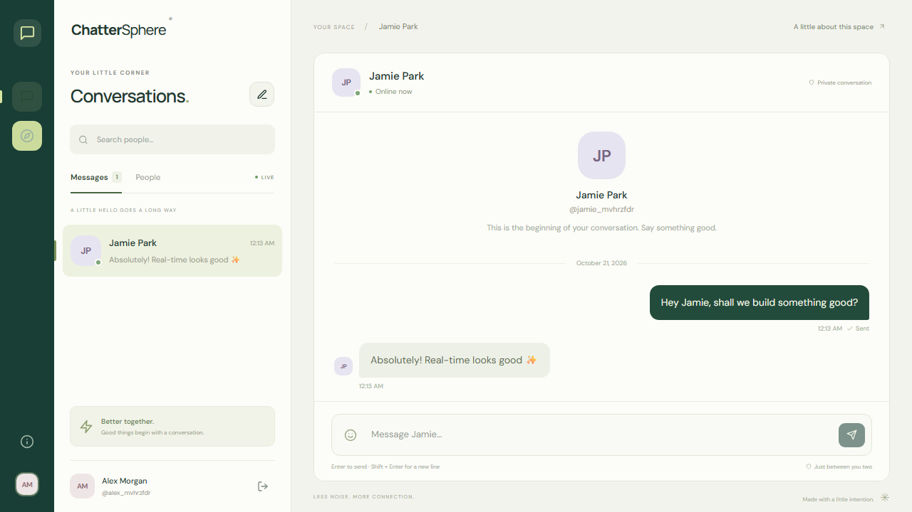

# ChatterSphere

A working one-to-one messaging portfolio project by Tong Wu. React, Express, MongoDB and Socket.io, rebuilt with a responsive interface and authenticated real-time delivery.



[Sign-in screen](docs/images/sign-in.png) · [Empty workspace](docs/images/workspace.png) · [Mobile conversation](docs/images/mobile.png)

## What works

- Register, sign in, restore a session, and sign out with server-side session revocation.
- Discover registered people by name or username; browse existing conversations.
- Exchange real, persisted text messages in real time across multiple browser sessions/devices.
- Reconnect and refresh history after a connection interruption.
- Load older messages with cursor pagination. Retry a send with the same ID without duplicating it.
- Responsive desktop/mobile layouts, keyboard sending, emoji picker, local in-memory drafts, and accessible native account/about controls.

No fake contacts or automated replies are inserted. To demonstrate chat, create two accounts in separate browser profiles (or use an incognito window). Sign up both, find the other person in **People**, and send a message.

## Run locally

Use Node **24.19.0** (see `.node-version`) and MongoDB. Source now lives directly at the repository root.

```sh
npm ci
npm ci --prefix frontend
cp .env.example .env
```

Set `MONGO_DB_URI` to a development database and `JWT_SECRET` to a cryptographically random value of at least 32 characters. Keep `.env` uncommitted. With `APP_ORIGIN=http://localhost:3000`, start the backend and Vite in separate terminals:

```sh
npm run dev
npm run dev --prefix frontend
```

Open `http://localhost:3000`. Vite proxies both `/api` and `/socket.io` to the backend on port 5000. For a local production-build preview, build the frontend, set `APP_ORIGIN=http://localhost:5000`, keep `NODE_ENV=development` for HTTP, and run `npm start`.

An isolated test preview is also available, with a disposable MongoDB process and no production credentials:

```sh
npm run build
npm run test:server
```

Open `http://127.0.0.1:5000`. Its accounts/messages disappear when the test process stops. Never use this command as a hosted service.

## Verification

```sh
npm run build
npm test
npx playwright install chromium
npm run test:e2e
npm audit --audit-level=moderate
npm audit --prefix frontend --audit-level=moderate
```

Integration tests launch a real, disposable MongoDB binary using `mongodb-memory-server`; the first run needs network access for that download. Browser tests launch two separate browser contexts against the built app and an ephemeral database. CI runs the same checks on Ubuntu and uploads browser evidence.

Covered behavior includes credentials and cookies, session revocation, authenticated sockets, forged identity, origin validation, input boundaries, rate limiting, independent recipient devices, third-party message isolation, idempotent sends, pagination, persisted history, reconnect recovery, XSS-as-text, mobile overflow, and signing back in. See [verification notes](docs/verification.md) for recorded results and scope.

## Deploy

[Deployment guide](docs/deployment.md) describes the Render Blueprint, MongoDB Atlas networking, environment values and smoke checks. `render.yaml` targets the review branch for initial validation; switch it to `main` after merging. It intentionally disables automatic deployment. `Dockerfile` is an alternative for a Node-capable host behind HTTPS.

The production process fails startup if database configuration or session secrets are missing, the HTTPS app origin is invalid, or the database cannot connect. It initializes indexes before accepting traffic. `/api/health` returns 503 when the database is unavailable.

## Security and boundaries

- JWTs are stored only in HttpOnly, SameSite=Strict cookies (Secure in production), backed by revocable MongoDB sessions. Socket identity comes from the same verified session. Logout closes sockets for that session; expiration closes long-lived sockets.
- Browser writes require the configured `APP_ORIGIN` and JSON. Socket requests with a cross-site Origin are rejected; same-origin polling can omit Origin but still requires a valid session.
- API/auth/message limits, bounded JSON payloads, bounded message text, explicit validation, bcrypt hashes, escaped directory searches, password-field exclusion and Helmet headers are in place.
- A message is one atomic MongoDB document. Existing legacy messages remain readable without the old conversation message-ID arrays. New writes use a sender-scoped idempotency index.
- Messages are **not end-to-end encrypted**. The service operator and database administrators can access stored content. Usernames/display names are discoverable by signed-in users; do not use sensitive data in this portfolio showcase.
- Presence and rate limiting are in process memory. Deploy **one instance**; distributed operation needs a shared Socket.io adapter and shared rate-limit store.
- This release supports one-to-one text messaging. Groups, attachments, read receipts, password reset, account deletion and moderation are outside this version. Unread badges and drafts are in-memory UI conveniences; they reset after reload/sign-out.
- No production database migration has been run. Use a dedicated showcase database. Review/back up any existing data before reusing a previous database; older usernames outside the new lowercase username rules need a migration plan.

## Structure

```text
backend/app.js           HTTP routes, session validation and socket lifecycle
backend/server.js        Configured production startup and graceful shutdown
backend/models/          User, Message and Session schemas/indexes
frontend/src/            React interface, request helpers and Zustand UI state
tests/                   Integration and browser tests
scripts/test-server.js   Disposable test-only server
render.yaml              Render service declaration
Dockerfile               Production container build
```

## Attribution

The original project was based on Burak's 2024 MIT-licensed chat tutorial. The original [MIT notice](LICENSE) is retained. The v2 refactor adds the redesigned UI, revocable shared HTTP/socket authentication, session-bound presence, message/query changes, input/origin/rate-limit protections, tests and deployment configuration. This does not claim authorship of the original tutorial foundation.

The prior project assessment is retained in [docs/README-before-refactor.md](docs/README-before-refactor.md) for historical context; its old paths and limitations describe the pre-refactor version.
